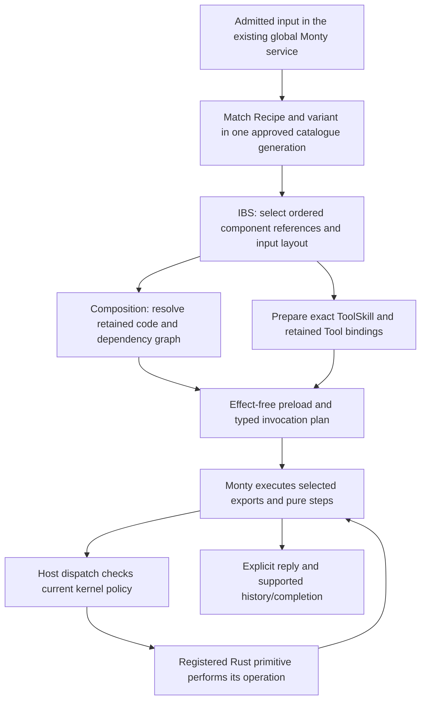

# Why Recipe authoring keeps turning into Rust work

> **Current execution boundary — 2026-10-22:** ordinary PostgreSQL/skills-db
> startup retains one `GlobalMontyOwner`; `GlobalMontyDriver` transports work to
> that service. `global_mode.py` sequences pinned retained preload exports and
> typed result handoffs. `basic_mode.py`, the old composer/step-body examples and
> per-chat bootstrap observations below describe legacy paths. Qualified source
> support, open migration/approval/recovery work and the owning plans are in
> [the current status index](implementation-status.md). Historical line numbers are inspection anchors,
> not current acceptance evidence. Reuse existing implementations.

**Review date:** 2026-10-17. **Inspected HEAD:** `6a36dfc5b225128512ff761c076620866baea163`.

## Executive conclusion

The intended architecture is already stated correctly in the principal contracts. The problem is not a missing sentence saying “Recipe first.” It is an inconsistent **authoring experience**:

1. Binding definitions coexist with contradictory examples and obsolete implementation descriptions.
2. The working retained execution/activation path is substantially newer than the principal authoring guide's “current implementation” sections.
3. The repository's visible examples reward creating a Recipe whose Python merely forwards to specialized Rust workflow handlers.
4. Component authoring has much less complete, directly usable guidance than Rust handler authoring.
5. Real remaining runner/approval gaps make some decompositions unavailable; guidance must route those gaps to shared infrastructure repairs, not task-specific Tools.

**Recommendation:** reconcile and demonstrate the existing architecture rather than adding another layer of prohibitions. Ship one qualified, reusable, multi-step reference workflow through the ordinary product path; make its exact authoring/deployment procedure the default agent entry point; and reject workflow logic hidden behind new Rust handlers in review.

This audit identifies plausible causes from documents and source. It does **not** establish why every previous agent made its decision: previous agent conversations, installed catalogues and production instances were not inspected.

## Scope and evidence limits

Reviewed the root agent/developer guidance, the four component authoring contracts, relevant path-specific rules and crate maps, the Reborn development skill, the named plans and their linked implementation/status material, and representative production-path source. Large implementation journals were inspected by relevant sections and source cross-checks, not treated as a line-by-line certification of every historical entry.

The task's shorthand `simplify_v3` resolves here to `./simplified_v3.md` and `./docs/plans/simplified-v3-implementation.md`. The Markdown-looking web links in the request were treated as references to local repository documents, not external websites.

The checkout already had unrelated and in-progress changes, notably catalogue/compiler work and memory/filesystem changes. Findings describe the inspected **working tree**, not necessarily HEAD alone. Those edits were not reverted or modified. No build, runtime test, remote connection, database query, deployment or component activation was performed. Previously recorded test results below are attributed evidence, not newly reproduced results.

## 1. The architecture agents should be taught

The user's description is substantially right, with three important clarifications:

- **Recipe:** declarative data consumed by IBS/composition, not Rust source and not an autonomous handler. Rust may legitimately seed or deserialize Recipe data; that does not make the Recipe a Rust workflow.
- **Composition:** deterministic selection/assembly of approved components, dependencies, exports and typed invocation data. “Fill variables” means data binding, **not inserting user text into Python source**. Tier 0 does not ask an LLM to invent the program.
- **Rust side:** ToolSkills are binding descriptors, not Rust programs to compile or independent instructions to execute task steps. Actual Rust operations happen only when invoked through the supported host/kernel boundary.

The “program” need not be one concatenated source string. In the current retained implementation it is a selected graph, preloaded definitions, fixed invocation source, typed bindings and an ordered flow. Monty drives that flow. Replacing it with a second giant generated program or Rust step loop is not necessary to realize the user's intent.

The output destination must be represented by supported Recipe/Tool inputs and the admitted conversation/run context. Do not invent a new persisted `destination` field because a conceptual description says “send it to the site specified in the Recipe.”

**Responsibility test:** if a change chooses which business step happens next, transforms task data, interprets domain output, or decides business completion, start with Recipe/PythonCode. If it enforces authority, immutable storage integrity, effect custody, transport, interpreter hosting or resource accounting, it may properly require Rust infrastructure. A genuinely missing primitive is a third, exceptional category.

This three-way distinction already exists in `./.agents/skills/reborn-feature/SKILL.md:47`; promote it rather than inventing a competing architecture.

## 2. Findings: documentation and instruction flaws

### F1 — The authoring guide describes the legacy path as the current path

**Priority: critical.**

`./recipe.md:46` dates its implementation observations to October 6. It subsequently describes:

- Capture/refinement failures retaining raw slots: `./recipe.md:303`.
- Plain source substitution and incomplete safe transport: `./recipe.md:351`.
- Multi-component includes silently selecting the first Python body: `./recipe.md:440`.
- Fresh state for each execution step: `./recipe.md:490`.
- Seed binding references with empty `tool_bindings`: `./recipe.md:587`.

These observations still matter for legacy APIs, but are not a correct blanket description of ordinary retained execution. Strict ordered IBS, typed retained inputs, preload/export qualification and authored activation now exist. The root guidance also contains both older gap statements and newer limited-runtime evidence.

**How this encourages Rust:** an agent reads the binding requirement for separate reusable steps, then reads that input transport, result sharing and binding preparation do not work. It sees no supported executable recipe for satisfying both and implements the entire operation behind one host call.

**Correction:** replace unqualified “current” passages with a path-specific capability table and exact navigation links. Explicitly distinguish legacy `compose_program` / `PgCompositionPort` from ordinary retained catalogue execution. Update each warning when the implementation changes; retain historical evidence in a separate history section. Do not delete warnings for the legacy path or claim all target behavior is supported.

### F2 — The principal worked Recipe is not a complete example of the binding interface

**Priority: critical.**

The binding preload rule is at the beginning of `./recipe.md`. However, its worked persisted example at `./recipe.md:500` is explicitly non-insertable, contains symbolic UUIDs, and ends in a top-level `result = host.post_reply(...)` body at `./recipe.md:558`. It omits a complete retained preload/export declaration, input layout, interface/association graph, approval selection and actual submission procedure.

That body is recognizable legacy step-body documentation, not the current activation example: `./crates/brassclaw_reborn_composition/src/authored_monty_catalogue.rs:483` requires qualified preload invocations for activated PythonCode.

**How this encourages Rust:** the agent has a usable Rust handler pattern but only a conceptual Recipe template that cannot be submitted as written. Producing more Rust is the concrete path it can follow.

**Correction:** preserve the schema explanation, but replace the main happy-path example with a qualified reference fixture and exact supported authoring/deployment walkthrough. Generate or check the displayed records from that fixture so prose cannot silently drift. Make “design-only” examples visually distinct and never the only worked example.

### F3 — Path-specific Tool guidance supplies the wrong default framing

**Priority: high.**

`./.claude/rules/tools.md:10` calls Tools “self-contained capabilities,” immediately gives the Rust handler implementation pattern, and does not first require a demonstrated missing primitive. Its dispatcher explanation still includes capability leases and invocation approval gates as if they were the final-v3 model.

`./crates/AGENTS.md:133` also routes readers to legacy grant/lease and exact-invocation-approval ownership. These are useful descriptions of existing code, but need explicit legacy applicability beside the descriptions, not just a distant precedence disclaimer.

The general injunction to keep Tool logic out of the agent loop is correct. **It does not imply that task behavior belongs in a Rust Tool.** Recipe/PythonCode is the missing third choice in the local rule.

**Correction:** lead the path-specific rule with the three-way responsibility test. Restrict the handler example to justified new primitives. Label existing lease/approval machinery as compatibility implementation pending the coordinated cutover; preserve kernel/technical enforcement. Do not use a documentation cleanup to bypass current security checks.

### F4 — Binding banners were added without retiring contradictory bodies

**Priority: high.**

The repeated preload-interface heading occurs in 50 Markdown files in this checkout. `./AGENTS.md` has 920 lines and `./CLAUDE.md` has 1,398. Repetition is not itself a correctness defect, but here it puts substantial pinning/MCP detail before the simplest component-authoring explanation while leaving incompatible material later in the same reading path.

Examples:

- `./README.md:229` presents the older agent-v3 documentation as the full system documentation.
- `./docs/agents-v3/05-skills-system.md:90` still lists classic parsing/selection modules; the current skills rule says that filesystem subsystem is removed: `./.claude/rules/skills.md:67`.
- `./recipe.md:248` recommends the Zencoder plan as an authoring reference with reconciliation caveats. But `./docs/plans/zencoder-extension-plan.md:180` still prescribes a Domain Skill, and `./docs/plans/zencoder-extension-plan.md:288` presents fresh per-step state as an invariant. Both conflict with the current contracts.
- `./crates/brassclaw_engine/src/types/ibs.rs:77` still documents retired `__execute_action__` dispatch. `./crates/brassclaw_engine/src/memory/composition.rs:33` describes consulting Skill bodies while stepping, and its executable-code comments describe source interpolation. Those comments sit beside newer typed code in the same module.

**How this encourages Rust:** agents follow search results and nearby concrete examples, not only the first banner. They infer a prose Skill system with a fixed set of Rust operations instead of an executable reusable Python library.

**Correction:** use short entry-point rules linked to a single canonical contract, then actually remove or quarantine incompatible prescriptions. Mark historical example sections where encountered. Update source docstrings with the exact API path they describe. Keep runtime Skills distinct from Codex/development skills.

### F5 — “No new Rust except a primitive” is too broad for migration work

**Priority: high.**

The primary rule around `./CLAUDE.md:265` says new Rust is warranted only for a new system Tool. But `./docs/development-policy.md:85` correctly allows infrastructure repairs for runner, binding, persistence, lifecycle and kernel support. The development skill likewise distinguishes task behavior, operator management and infrastructure.

**How this encourages specialized Tools:** an agent needing a real runtime repair can misclassify it as a new Tool to satisfy the blanket rule, rather than repair the shared runner. Conversely, an agent may claim a Recipe alone implements missing infrastructure.

**Correction:** state “new task workflows must not be implemented as specialized Rust Tools,” not “no new Rust.” Require a named ownership decision and source-based gap before either infrastructure or primitive changes. A Recipe design remains first; it is not proof the required runtime is already implemented.

Also align `./CLAUDE.md:335` with the seed exception: the generic capability checklist currently asks for human Q2 without locally distinguishing installation-owned shipped components from installed-instance authored changes.

### F6 — Plans mix target requirements, historical status and later corrections

**Priority: high.**

The active documents already warn against specialized Rust workflows. Their weakness is status navigation, not architectural intent.

- `./docs/plans/monty.composition.md:329` describes an October 9 limited catalogue and says authored activation is remaining work. Section 35 at `./docs/plans/monty.composition.md:2007` records authored activation and ordinary-caller acceptance from October 10.
- `./validator_v3.md:86` inventories earlier source-inspection limitations. The current retained preload parser and source inspector have evolved. The eight-validator conversion remains open, but it should not prompt a second loader implementation.
- `./docs/plans/prefix_v3_upgrade.md:46` has a useful reconciliation table and later Phase C updates. Its status must be read as implementation slices, not “all absent” or “all complete.” Compiler/bootstrap files are also being edited in this working tree.
- `./docs/plans/simplified-v3-implementation.md` is a large chronological implementation journal; the root still emphasizes an October 8 status slice.

**Correction:** give each plan a short current dependency/status index pointing to the existing owner and exact acceptance scope. Mark superseded snapshots inline, retain their original evidence, and avoid copying fresh status paragraphs into every contract. A shared status index should distinguish source support, local caller acceptance and deployment.

### F7 — “Recipe exists” can disguise the wrong ownership

**Priority: critical; demonstrated in current source.**

The post-turn review has a real Recipe and associated Python exports, but most exports simply forward `record_bytes` to specialized `host.review_*` operations: `./crates/brassclaw_skills/src/completed_turn_review_components.rs:183`.

The Rust backend then:

- Selects/correlates evidence and composes the review bundle: `./crates/brassclaw_reborn_composition/src/completed_turn_review/backend.rs:229`.
- Interprets the proposal response: `./crates/brassclaw_reborn_composition/src/completed_turn_review/backend.rs:164`.
- Iterates over candidate submissions: `./crates/brassclaw_reborn_composition/src/completed_turn_review/backend.rs:174`.
- Produces review completion classifications and receipts: `./crates/brassclaw_reborn_composition/src/completed_turn_review/backend.rs:209`.

Some of this code is necessary trusted custody/integrity logic. The problem is the mixture with evidence-selection policy, domain interpretation and effect iteration. A Recipe and one-line wrappers do not establish that Python owns the workflow.

**Correction:** adopt the responsibility separation already specified in `./docs/plans/sempai_v3.5.md:15` and its final responsibility review at `./docs/plans/sempai_v3.5.md:400`. Move policy/transformation/iteration to components without weakening Rust's real correlation, immutable storage, fencing and accounting checks. Do not replace seven specialized Rust methods with one monolithic Python method.

### F8 — Reuse discovery and review lack a practical architecture gate

**Priority: high.**

The guides tell agents to search archives, seeders and stores. Much of the older library is embedded in the very large `./crates/brassclaw_reborn_composition/src/builtin_bootstrap.rs`, including legacy placeholder bodies. A matching name or `validated` flag does not identify an admissible retained usage. Current operator deployment documentation exists, but is not the primary authoring walkthrough: `./docs/reborn/component-deployment.md:1`.

The inspected architecture tests enforce important crate/dependency boundaries. No dedicated Recipe-first/new-primitive justification gate was found in the inspected architecture tests and check-script searches. Such a gate cannot be replaced by checking that a Recipe row exists.

**Correction:** provide an owner-derived inventory of actually selectable usages: stable identity, exports, recursive contracts, compatible binding, retained implementation, approval/support state and consumers. Reuse the active catalogue and source-export owners; do not introduce another authoritative registry. Require a review record for new Rust capabilities and changed workflow handlers, and inspect where the behavioral choices actually execute.

## 3. Current implementation: what exists and what does not follow from it

| Area | Source observation | Interpretation |
| --- | --- | --- |
| Global lifecycle | `./crates/brassclaw_reborn_composition/src/runtime.rs:2804` starts the global owner/catalogue before worker/producer startup; `./crates/brassclaw_reborn_composition/src/global_monty_startup.rs:27` owns startup. | Do not propose a new per-chat VM, lifecycle owner or second executor. This is source tracing, not a new runtime acceptance result. |
| Recipe-to-IBS | `./crates/brassclaw_engine/src/memory/instruction_builder.rs:596` provides strict ordered building; the one-UUID check is at line 701. | Recipes are structured data, not generated Rust. The strict path differs from the compatibility builder. |
| Typed composition | `./crates/brassclaw_engine/src/memory/composition.rs:193` preserves selected source; at line 285 it rejects source placeholders. The old substituting composer remains at line 338. | “Composition substitutes user strings” is a legacy-path description, not the retained target behavior. |
| Retained selection | `./crates/brassclaw_engine/src/memory/retained_instruction.rs:37` retains snapshot, Recipe, variant and ordered instruction; `retained_selection` at line 68 serializes exact selection. | A bare legacy BuildInstruction is not the whole production selection contract. Do not demand a duplicate manifest/store solely because that older struct lacks every field. |
| Typed result flow | `./crates/brassclaw_engine/src/memory/retained_inputs.rs:204` emits typed step bindings; `./crates/brassclaw_engine/orchestrator/global_mode.py:175` passes inputs and retains returned results in task state. | Cross-step data flow is implemented for supported workflows. Arbitrary shared mutable globals are neither required nor permitted. |
| Preload/export interface | `./crates/brassclaw_engine/src/executor/retained_preload.rs:81` parses `python-preload/2`; line 152 builds a fixed invocation. `./crates/brassclaw_engine/src/executor/retained_recipe.rs:693` loads inspected definitions before invocation. | The blanket claim “preload machinery is not implemented” is obsolete. This does not prove every target language construct or catalogue component is supported. |
| Source qualification | `./crates/brassclaw_engine/src/executor/retained_source.rs:416` documents conservative restrictions on reachable Tool-calling functions. | Do not evade unsupported recursion/aliases/closures/repeated dispatch with source rewriting or a large workflow Tool. |
| Ordinary task composition | `./crates/brassclaw_reborn_composition/src/global_recipe_ports.rs:520` resolves the task-retained selection and binds the typed envelope. | Inspect this ordinary caller before drawing conclusions from the older compose host API. |
| Authored activation | `./crates/brassclaw_reborn_composition/src/authored_monty_catalogue.rs:90` activates existing approved usages; line 636 verifies retained native implementation identity. | Activation support is real, but restricted to supported graphs/adapters. It is not an arbitrary new native Tool loader. |
| Pure-code approval coverage | `./crates/brassclaw_reborn_composition/src/authored_monty_catalogue.rs:497` rejects graph dependencies outside supported approval coverage. | General standalone pure-Python deployment must not be assumed. Explain which helper closures qualify and which need the missing approval contract. Do not invent zero-Tool Skills to bypass this boundary. |
| General flow support | `./crates/brassclaw_engine/orchestrator/global_mode.py:60` recognizes broader flow forms, but retained input lowering emits a flat flow and `./crates/brassclaw_engine/src/executor/retained_recipe.rs:611` enforces the next flat occurrence. | Python interpreter syntax is not complete runner support. Repeated effectful item execution needs the existing planned occurrence/journal extension, not a Rust domain loop. |
| Validator pipeline | `./crates/brassclaw_reborn_composition/src/q1_orchestrator.rs:151` accepts exactly one description/step/body. `./crates/brassclaw_reborn_composition/src/builtin_bootstrap.rs:12157` still contains the shared nonempty-field validator seed. | The eight class-specific retained validation Recipes are not established by this older runner. New retained Q1/evidence helpers do not prove the full validator conversion. |
| Seeded legacy library | Legacy bodies include direct placeholders and outdated adapter assumptions, e.g. `./crates/brassclaw_reborn_composition/src/builtin_bootstrap.rs:4140`. | Seed presence is migration material, not proof a usage is executable or approved in the active retained catalogue. |

Previously recorded local acceptance is stronger than a design-only claim, but narrower than full-v3 completion. `./docs/authored-catalogue-activation.md` records ordinary operator/PostgreSQL/global-Monty acceptance for the supported activation path. `./docs/reborn/component-deployment.md` records deployment preparation/activation integration and its limitations. These results were **not rerun** here; their applicability to the concurrently edited tree needs the normal evidence review.

## 4. How the named plans should fit together

| Document | Keep / use | Correction to the handoff |
| --- | --- | --- |
| `./validator_v3.md` | Eight validator Recipes, reusable facts/checking components, retained subjects, trusted evidence and distinct authored/bootstrap qualification. | Reconcile existing preload/source-inspection progress; complete ordinary admission and multi-step validation without introducing another loader, store or Rust validator workflow. |
| `./docs/plans/monty.composition.md` and appendices | Component migration/reuse inventory, canonical execution Recipes, exact interfaces and binding qualification. | Make the latest supported implementation entry explicit. Convert legacy examples to actual retained exports, not renamed one-line wrappers around new workflow Tools. |
| `./docs/plans/prefix_v3_upgrade.md` | Recipe-owned snapshot → compile → validate → publish; one bounded compiler-worker primitive where genuinely necessary; source/model/artifact integrity. | Preserve the distinction between compiler infrastructure and generation sequencing. Do not interpret Phase B/C helper acceptance as full job/resolver/activation completion. Reconcile the current compiler work before adding anything. |
| `./simplified_v3.md` and its implementation journal | Shared global Monty, coherent catalogue, live policy/settings and coordinated legacy cutover. | Use it as shared infrastructure ownership, not an excuse to implement every capability in Rust while waiting for “all v3.” List the precise missing contract per Recipe. |
| `./docs/plans/simplify_connections_v3.5.md` | One owner per connection/auth/transport/admission/recovery responsibility; domain-specific evidence stays distinct. | Keep this consolidation separate from moving business logic. It must not become a universal Rust workflow/recovery Tool or a new broker. |
| `./docs/plans/sempai_v3.5.md` | Directly addresses the demonstrated wrapper/Rust-workflow problem and requires a second real consumer for shared parts. | Treat as compliance/conversion work under existing v3, not permission to postpone v3 ownership until a new architecture version. Reconciliation/deployment infrastructure does not complete this conversion. |

The two v3.5 proposals are largely aligned with the intended architecture. They do not replace v3 or authorize a wholesale rewrite. Their value is explicit ownership and reuse, especially the distinction between generic durable mechanics and domain sequencing.

## 5. Proposed corrections, in priority order

### P0 — Correct the agent entry path and its examples

1. Condense `./AGENTS.md` into routing and nonnegotiable ownership rules. Put detailed component semantics in the four canonical guides and development procedure in the existing policy/skill. Keep compatibility notes clearly scoped.
2. Amend `./CLAUDE.md` and `./.claude/rules/tools.md` to use the same task-behavior / infrastructure / primitive decision. Mark legacy authorization statements locally.
3. In `./README.md`, link the four current contracts, the supported authoring walkthrough and the current implementation-status index before older subsystem tours.
4. Replace the incomplete main example in `./recipe.md` with a fixture-backed retained export example. Explain the supported record shapes without inventing API fields.
5. Remove the Zencoder plan from the default worked-example route until its bodies are migrated. Historical references remain available, but are not copy templates.
6. Update stale source comments in the IBS/composition types. Keep the development-skill copies synchronized if that skill changes.

**Proposed short entry-point instruction:**

> First specify the Recipe: existing component identities, ordered usages, typed inputs/results, result destination, completion and missing support. Task behavior belongs in Recipe/PythonCode. Search the actual approved catalogue and retained adapters before creating components. New Rust must be justified as either a shared infrastructure repair or one genuinely missing primitive; it must not choose or conceal the task workflow. Emit supported persisted records, qualify exact exports/bindings, then use the existing review/bootstrap and activation path. A Recipe wrapping Rust workflow handlers does not satisfy this rule.

This is a proposed replacement instruction, not a new runtime component or activated policy.

### P1 — Make component authoring concretely executable

- **Inventory:** publish a catalogue-owner-derived authoring view distinguishing active/approved, retained-only, draft and legacy rows. Include exact exports and parameter/result schemas, not just names/classes.
- **Walkthrough:** document the existing immutable submission → trusted usage qualification → deployment preparation → explicit activation → ordinary matching path. Supply real request shapes and negative cases. Start from `./docs/reborn/component-deployment.md`, not a parallel submission mechanism.
- **Shipped components:** demonstrate the distinct installation-owned integrity/Q1/behavior qualification path. Do not request instance human Q2 for reviewed bundled seeds; do not let an operator edit gain bootstrap provenance by changing a label.
- **Examples as checked artifacts:** source displayed JSON/Python from accepted fixtures and verify that the docs and fixture agree. Include one typed prior-result handoff and one reusable pure dependency, not just a fixed reply.
- **Readiness:** document exact activation boundaries, including standalone pure-code approval coverage and supported native adapters. Missing support must produce a named infrastructure item, not an invented field or specialized workflow Tool.

Externalizing seed assets may improve authoring, but is not a prerequisite for acknowledging that Recipe data can be seeded in Rust. If undertaken, preserve packaged checksums, noncircular bootstrap qualification, upgrade/override rules and old task selections. Do not remove integrity checks to make edits convenient.

### P2 — Finish the specific shared support demanded by real Recipes

- Implement the occurrence/flow and durable-effect support needed for Sempai's per-candidate submission, through the existing retained executor and journal owner. Preserve partial/unknown effects and positive attempt identities; no whole-workflow replay.
- Complete the supported approval route for standalone pure components where a concrete reference Recipe requires it. Do not manufacture a ToolSkill/Skill for zero-Tool logic.
- Convert Sempai's evidence selection, envelope interpretation and iteration to reusable components, retaining Rust storage/transport/integrity/fencing/accounting primitives.
- Convert the eight-validator path through ordinary retained IBS/composition/admission. Reuse current structural/evidence machinery rather than creating another validator engine.
- Continue prefix work through its existing catalogue/compiler owners. A bounded compiler primitive must return artifacts; it must not silently own source selection, validation and publication.

These are targeted repairs in the active plans, not a proposal for a new generic workflow framework.

### P3 — Enforce ownership with review and ordinary-caller acceptance

For each new Tool or changed host handler require:

1. Candidate Recipe and component reuse map.
2. Exact missing primitive or infrastructure contract, with source evidence.
3. Classification of every new responsibility: transformation/workflow, storage, transport, integrity, kernel or accounting.
4. Explanation of why existing primitives plus Python cannot provide the operation.
5. Actual retained identity, binding and approval/bootstrap route.
6. Acceptance through the ordinary caller, including refusal/failure/no-replay behavior.

A cheap CI rule can flag changed Tool registrations/handlers without this record. A semantic reviewer must decide whether the operation hides task workflow; regex cannot prove that, and counting `host.*` calls is insufficient. Keep mechanical class/binding/preload/input checks in the existing validators, not a second validation framework.

## 6. A reference Recipe that would teach the right pattern

**Illustrative design only:** “read a text file, select lines containing a literal, and reply.” Resolve actual approved components and adapter contracts before authoring records; no UUIDs or APIs are invented here.

| Order | Persisted knowledge | Referenced component | Typed handoff |
| --- | --- | --- | --- |
| 1 | `rust` | One compatible file-read ToolSkill UUID | Availability only |
| 2 | `orchestrator` | One associated file-read PythonCode UUID | Validated path → actual read payload |
| 3 | `orchestrator` | One pure line-selection PythonCode UUID | Prior payload's declared content field + literal → selected lines |
| 4 | `orchestrator` | One pure formatting PythonCode UUID | Selected lines → answer string |
| 5 | `rust` | One qualified reply ToolSkill UUID | Availability only |
| 6 | `orchestrator` | One associated reply PythonCode UUID | Answer → correlated reply receipt |

The ordinary supported history/completion owner then handles its responsibilities without publishing the answer twice. Preload definitions/dependencies before invocation; it is not an additional effect step. Every component step has one UUID and uses `knowledge` / `stepnumber`, not conceptual `channel` fields. Runtime values stay data.

The line-selection export can also serve a read-only log-inspection Recipe by the same component UUID; formatting can serve other list replies. There should be **no new Rust `read_filter_reply` Tool**. If the selected graph cannot activate because pure-helper approval coverage is missing, implement that precise shared contract before claiming this reference works.

Reference acceptance should establish:

- Ordinary intent/variant selection reaches the Recipe, not Tier-2 fallback.
- Two workflows share the same immutable helper revision rather than copied source.
- Typed hostile strings remain data; invalid inputs fail before effects.
- Preload is effect-free; every actual Tool dispatch passes current policy.
- Results cross steps correctly, with isolated concurrent task/attempt state.
- New activations affect new tasks; already captured tasks keep old exports/artifacts.
- Reply/history ownership is exact; late failures never replay a completed effect.
- Tier-0 eligibility is actually observed where applicable, not asserted by a flag.

## 7. What should not be changed in response to this audit

- Do not ban Rust seeding of declarative Recipe/component data.
- Do not move trusted kernel, transport, immutable retention or reconciliation evidence into untrusted Python merely to reduce Rust line count.
- Do not replace the existing global service, catalogue, loader, activation store or component submission path.
- Do not adopt direct source substitution, execute prose, invent persisted fields or give one step several component UUIDs.
- Do not relax approval/integrity requirements or claim full-v3 completion from document edits, parser support or existing local test names.
- Do not deploy either v3.5 proposal merely because it is referenced here.

**Bottom line:** the repository needs one coherent, executable authoring path and a responsibility-based review gate—not another repeated “Recipe first” banner. The most important implementation correction is to stop treating thin Python wrappers around Rust business workflows as successful Recipe architecture.
